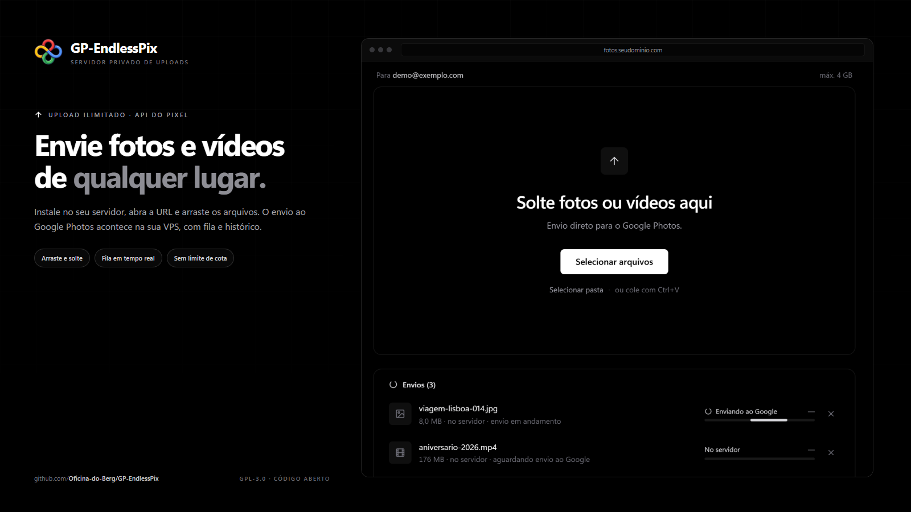
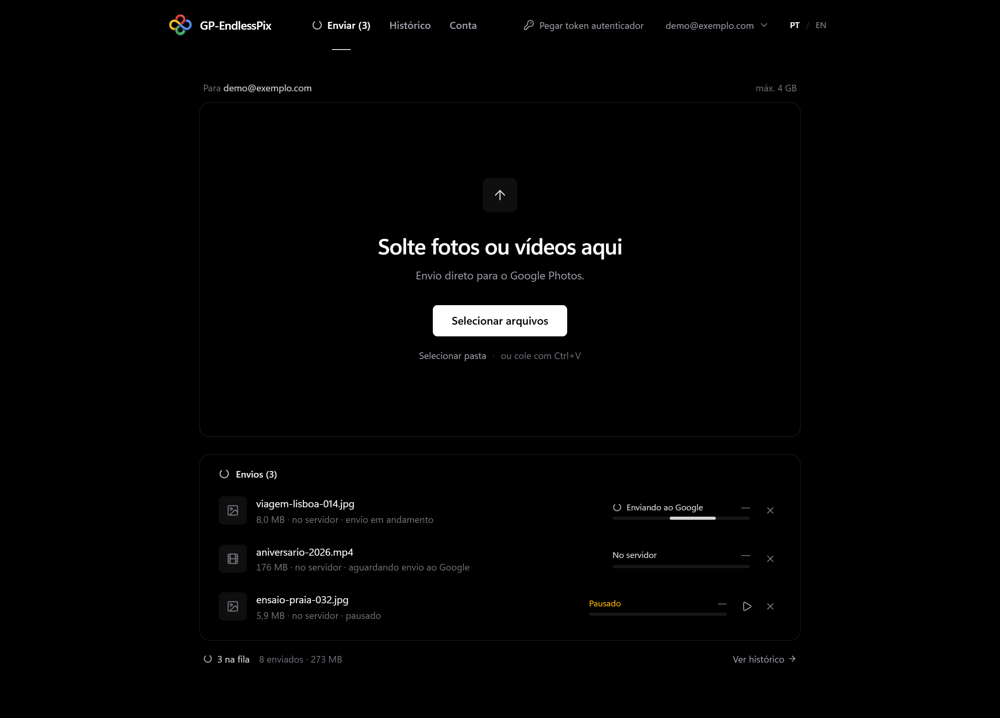
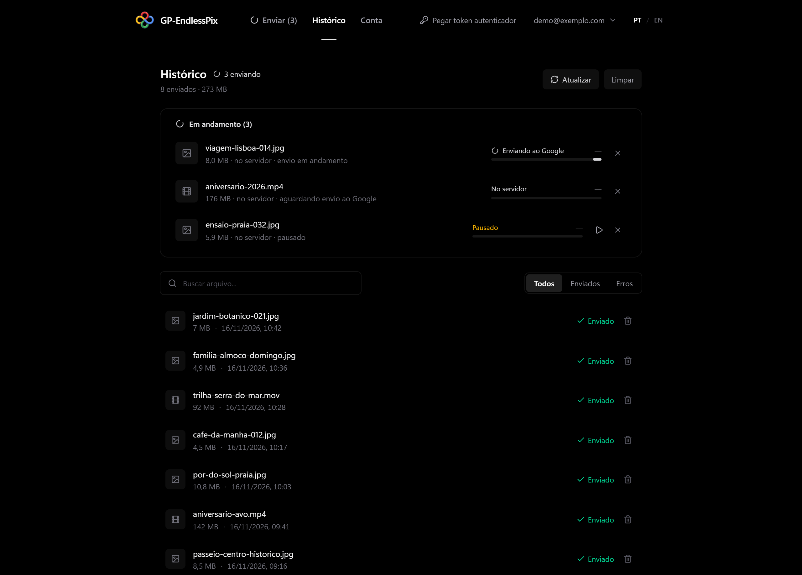

# GP-EndlessPix

**Upload ilimitado para o Google Photos, no seu próprio servidor.**

Instale em uma VPS, publique uma URL e envie fotos e vídeos de qualquer
dispositivo. O app usa a API do Pixel para enviar em qualidade original sem
consumir a cota da conta.

<p align="center">
  
</p>

<p align="center">
  <a href="docs/INSTALACAO.md"><strong>Instalação</strong></a> ·
  <a href="docs/OPERACAO.md">Operação</a> ·
  <a href="docs/ARQUITETURA.md">Arquitetura</a> ·
  <a href="docs/SEGURANCA.md">Segurança</a> ·
  <a href="docs/FAQ.md">FAQ</a>
</p>

<p align="center">
  
  
  
  
</p>

> **Upload ilimitado via API do Pixel.** O GP-EndlessPix usa o `gotohp-cli`
> para se autenticar como um dispositivo Pixel e enviar arquivos em qualidade
> original, sem descontar do armazenamento do Google Photos. É uma integração
> não oficial: pode contrariar os termos do Google e resultar em bloqueio da
> conta. Teste primeiro com uma conta secundária. O projeto não é afiliado ao
> Google.

---

## Visão geral

O GP-EndlessPix é uma aplicação web **auto-hospedada**. Na prática, ele
transforma uma VPS em um servidor particular de uploads:

1. você instala o projeto na VPS;
2. aponta um domínio para o servidor;
3. o Caddy publica o app em HTTPS;
4. qualquer navegador com a senha consegue abrir a interface e enviar arquivos.

Não existe um servidor central da Oficina do Berg nem compartilhamento de
contas. Cada pessoa roda a própria instância, com a própria senha, o próprio
banco e a própria conta Google.

O caminho recomendado de hospedagem é uma **VPS Linux comum**. O guia também
inclui uma seção opcional para sandboxes Instabox, útil apenas para testes.

---

## Upload ilimitado com a API do Pixel

O GP-EndlessPix não depende de Google One nem de espaço extra na conta. O
`gotohp-cli` se apresenta ao Google como um **dispositivo Pixel XL** e envia os
arquivos em **qualidade original**, sem descontar da cota do Google Photos.

O limite é apenas por arquivo, definido em `MAX_UPLOAD_MB` (4 GB por padrão).
Não há limite de quantidade nem cobrança por upload.

Como é uma integração não oficial, o comportamento pode mudar sem aviso e o uso
está sujeito aos termos do Google. Teste primeiro com uma conta secundária.

---

## Hospedagem

A hospedagem é o que transforma o projeto em um serviço acessível de qualquer
lugar. O app não roda no seu computador: ele fica ligado na VPS, atrás de um
domínio, e o navegador apenas consome a interface.

| Camada | Papel |
|---|---|
| **VPS** | Mantém o app, o banco, o token e os temporários |
| **Domínio** | Dá um endereço estável, como `fotos.seudominio.com` |
| **Caddy** | Emite e renova o certificado HTTPS automaticamente |
| **Docker** | Empacota o app e reinicia os containers após falhas |
| **Volume** | Preserva histórico e credenciais entre atualizações |

Na prática, você contrata uma VPS, instala o projeto uma vez e aponta o DNS.
Depois disso, a URL fica disponível enquanto a VPS estiver ligada. O upload pode
ser feito do celular, do tablet ou de outro computador, em qualquer rede — não é
necessário estar perto do servidor nem instalar um aplicativo.

Só as portas **80 e 443** ficam públicas. A porta interna do app não é exposta.

---

## Como funciona

```text
Navegador (celular, tablet ou PC)
        │  HTTPS
        ▼
Caddy na sua VPS (443)
        │  proxy interno
        ▼
GP-EndlessPix (8000, interno)
        │
        ├─ salva o arquivo temporariamente
        ├─ registra o job no SQLite
        └─ worker chama o gotohp-cli
                │
                ▼
        Google Photos
                │
                └─ o temporário é apagado após o sucesso
```

- O navegador é só a interface. Quem envia ao Google é o `gotohp-cli`, que se
  autentica como um Pixel XL e não consome a cota da conta.
- Um worker processa a fila, um arquivo por vez, com até 3 tentativas.
- Se o arquivo já existir no Google Photos, o gotohp marca como "skipped" e o
  app trata como sucesso.
- O nome original e a data de modificação do arquivo são preservados.
- Upload concluído apaga o temporário. Upload com erro **mantém** o arquivo
  para o botão **Reenviar** do histórico funcionar.
- Depois que o arquivo chega ao servidor, o envio continua mesmo se você fechar
  a aba do navegador.

Stack: Python 3.12, FastAPI, SQLite, React 19, Vite 8, Tailwind CSS 4 e
`gotohp-cli` v0.11.0.

---

## Interface

<p align="center">
  
  
</p>

A interface tem três áreas:

- **Enviar** — arraste arquivos, selecione uma pasta ou cole do clipboard.
- **Histórico** — acompanhe enviados, erros e reenvios.
- **Conta** — conecte, troque ou remova a conta Google ativa.

---

## Recursos

| Recurso | Detalhe |
|---|---|
| Upload ilimitado | API do Pixel, qualidade original e sem consumo da cota |
| URL própria | Acesso por domínio e HTTPS automático via Caddy |
| Upload remoto | Funciona de qualquer navegador, sem instalar cliente |
| Fila resiliente | Pausa, cancelamento, retry e recuperação após reinício |
| Histórico | Banco SQLite local com status, tamanho e data |
| Dados sob seu controle | Token, banco e temporários ficam na sua VPS |
| Deploy reproduzível | Docker Compose, healthcheck e volume persistente |
| x86_64 e ARM64 | Binário do gotohp selecionável no build |
| Uso pessoal | Uma senha de site e uma conta Google por instalação |

---

## Começar rápido

### Requisitos

- VPS Linux x86_64 com 1 GB+ de RAM
- 20 GB+ de disco para fotos (40 GB+ para vídeos)
- Docker Engine + Docker Compose v2
- Domínio com registro **A** apontando para a VPS
- Portas 80 e 443 liberadas

### Deploy

```bash
git clone https://github.com/Oficina-do-Berg/GP-EndlessPix.git
cd GP-EndlessPix
cp .env.example .env
nano .env
chmod +x deploy.sh scripts/*.sh
./deploy.sh
```

No `.env`, ajuste pelo menos:

```dotenv
APP_PASSWORD=uma-senha-longa-e-unica
DOMAIN=fotos.seudominio.com
COOKIE_SECURE=1
DRY_RUN=0
```

Depois abra `https://fotos.seudominio.com`, entre com a senha e conecte a conta
Google em **Conta → Conectar outra conta**.

O passo a passo completo, incluindo DNS, firewall, migração de dados,
Cloudflare, ARM e a seção opcional do Instabox, está em
**[Instalação](docs/INSTALACAO.md)**.

---

## Documentação

| Página | Conteúdo |
|---|---|
| [**Instalação**](docs/INSTALACAO.md) | Requisitos, VPS, DNS, `.env`, deploy, token do Google, migração, Cloudflare, ARM e Instabox |
| [**Operação**](docs/OPERACAO.md) | Atualização, logs, saúde, backup, restauração e problemas comuns |
| [**Arquitetura**](docs/ARQUITETURA.md) | Componentes, fluxo da fila, banco, API e decisões de projeto |
| [**Segurança**](docs/SEGURANCA.md) | Modelo de acesso, token, backups, checklist e resposta a incidentes |
| [**FAQ**](docs/FAQ.md) | Domínio, acesso remoto, armazenamento, contas, limites e termos do Google |

---

## Segurança e limites

- Use **HTTPS** e `COOKIE_SECURE=1` em produção.
- Use uma senha longa e única; o site fica exposto na internet.
- O `oauth_token` vale como senha da conta Google. Nunca o exponha.
- O backup do volume contém o token: guarde-o como um segredo.
- Uma instalação atende **um usuário e uma conta Google por vez**.
- O app não apaga nada do Google Photos.
- O upload ilimitado usa uma integração não oficial com a API do Pixel; isso
  pode violar os termos do Google e resultar em bloqueio.

Leia o [guia de segurança](docs/SEGURANCA.md) antes de colocar dados reais em
produção.

---

## Licença

Distribuído sob a GNU General Public License v3.0. Veja [LICENSE](LICENSE).

Google Photos é uma marca do Google. Este projeto é independente e não possui
vínculo com a empresa.
